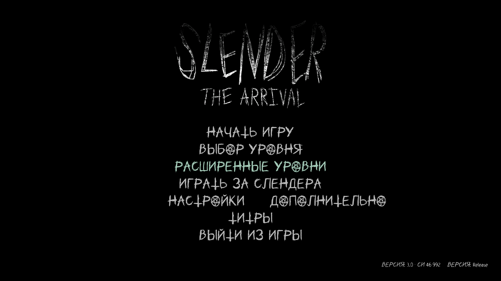
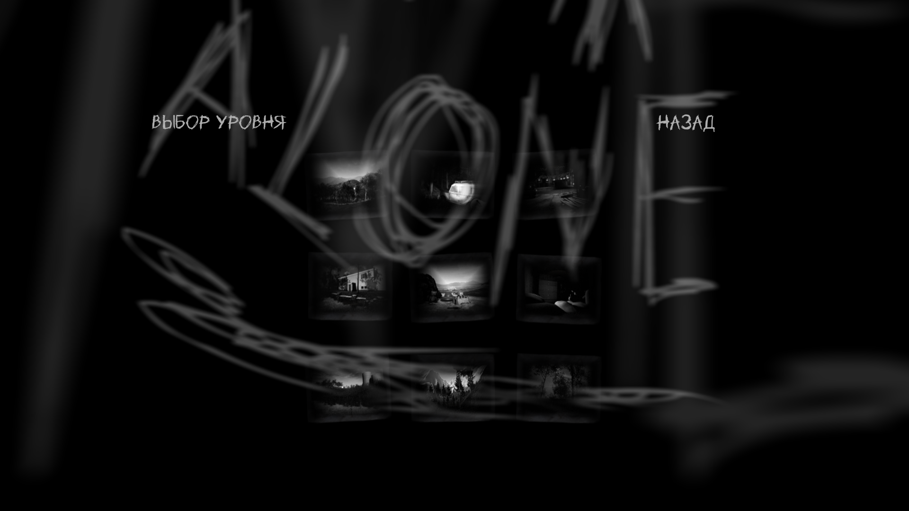
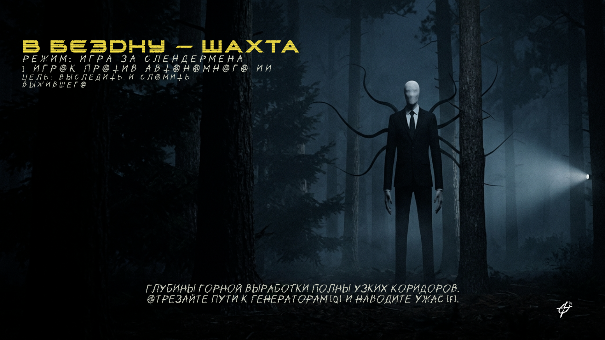
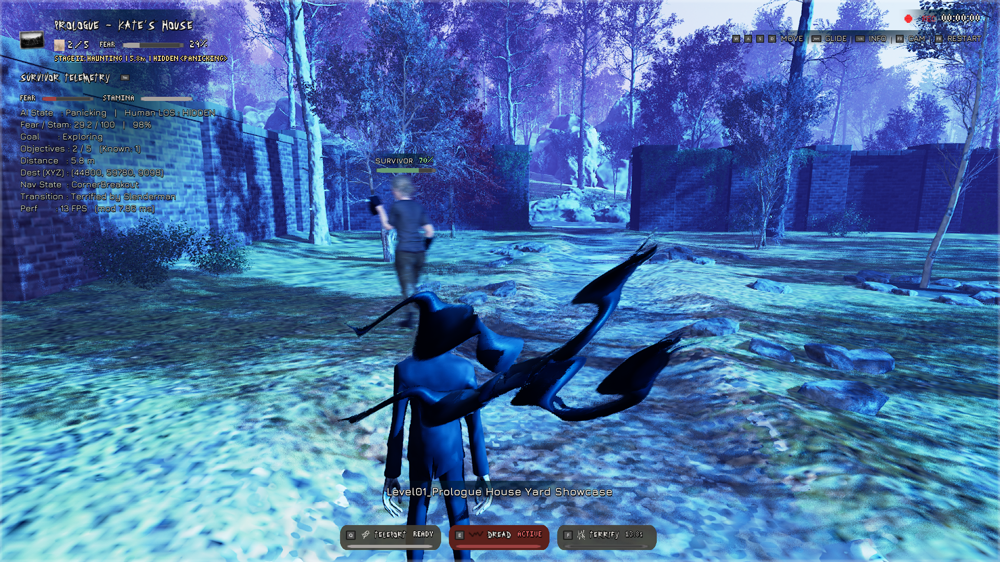
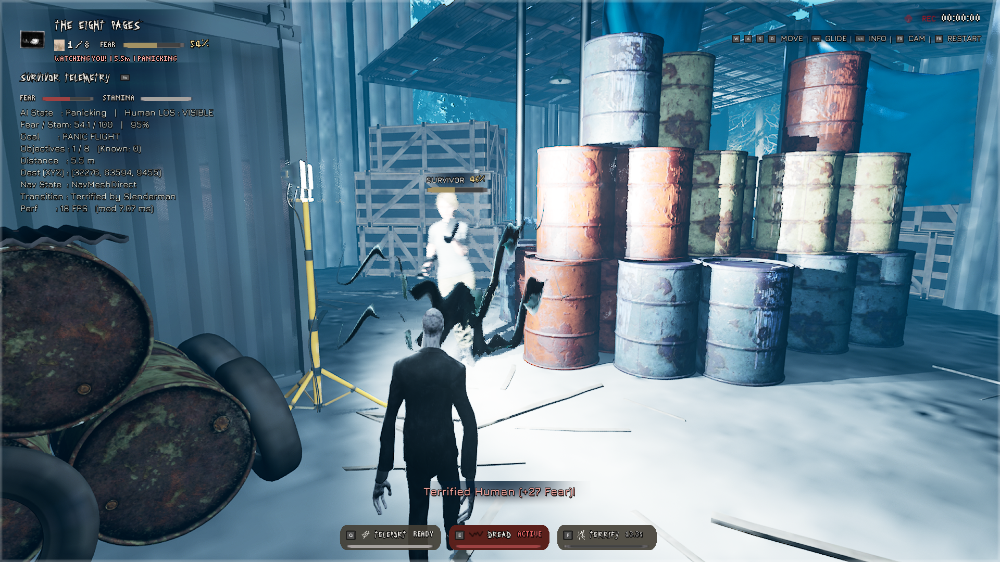
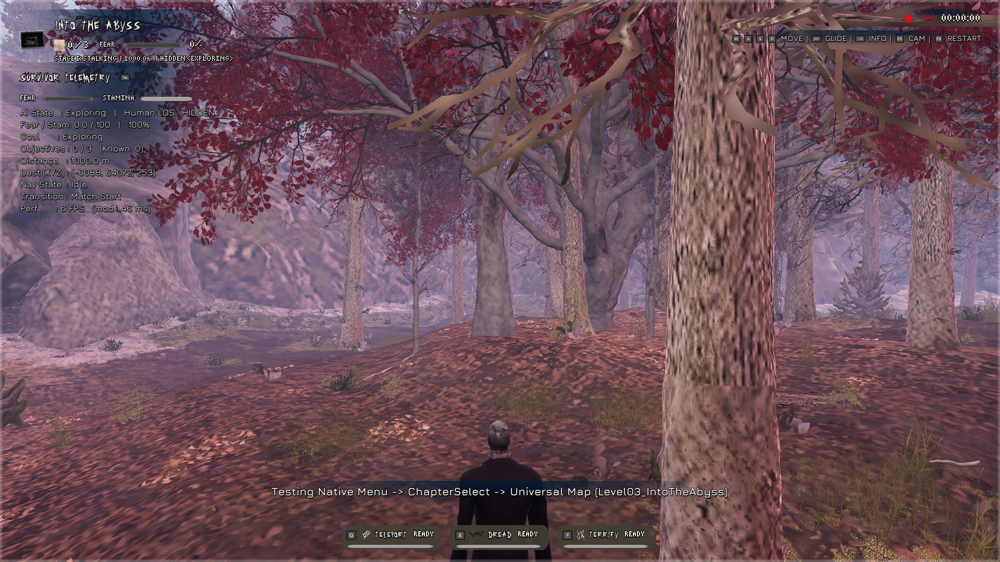
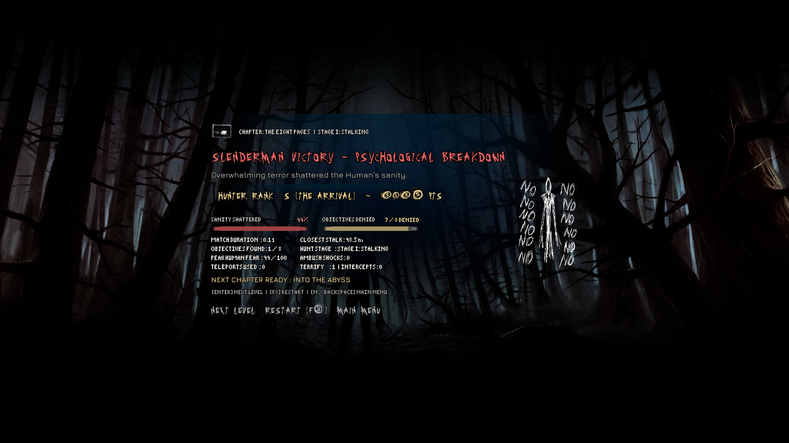
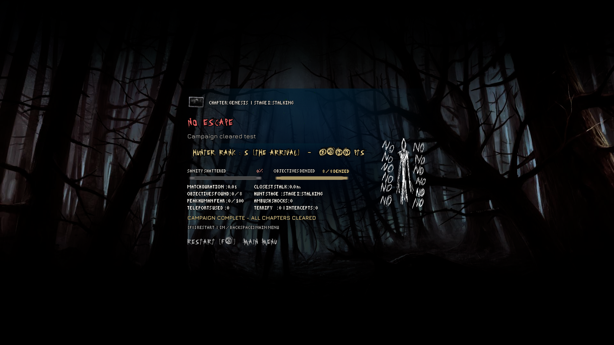

# Play as Slender — Модификация для Slender: The Arrival (UE 5.3 / UE4SS)

> **Русский (основное руководство)** | [English Guide](#english-guide)

Модификация **Play as Slender** превращает *Slender: The Arrival* (10th Anniversary Edition, Unreal Engine `5.3.0`) в асимметричный режим игры **за самого Слендермена** против автономного, не всеведущего ИИ выжившего — **без изменения оригинальных `.exe`, `.pak`, `.ucas` и `.utoc` файлов игры**.

---

## Содержание
- [Ключевые возможности](#ключевые-возможности)
- [Скриншоты](#скриншоты)
- [Автоматическая установка (PowerShell)](#автоматическая-установка-powershell)
- [Ручная установка (без PowerShell)](#ручная-установка-без-powershell)
- [Управление и горячие клавиши](#управление-и-горячие-клавиши)
- [Руководство по игре и система рангов](#руководство-по-игре-и-система-рангов)
- [Устранение неполадок](#устранение-неполадок)
- [Полное удаление мода](#полное-удаление-мода)
- [English Guide](#english-guide)

---

## Ключевые возможности

- **Нативная интеграция в главное меню**: в штатное меню `W_SubMenu_Main` добавляется кнопка **`ИГРАТЬ ЗА СЛЕНДЕРА`** на базе родного виджета `W_Button_C`. Обычные кнопки меню по-прежнему запускают оригинальную игру без вмешательства мода.
- **Кампанейская прогрессия глав**: прогресс сохраняется в `ue4ss\PlayAsSlender_progress.ini` (`unlocked_max=1` по умолчанию). Изначально открыта только 1-я глава (`Level01_Prologue`); каждая победа за Слендермена открывает следующую главу в меню выбора глав (`W_SubMenu_ChapterSelect`), а поражение оставляет её закрытой.
- **Поддержка всех глав игры**: адаптированы как открытые лесные карты с `RecastNavMesh` (`Level02_TheEightPages`, `Level03_IntoTheAbyss`, `Level04_Flashback`, `Level05_TheArrival`, `Level07_Memories`, `Level08_Homestead`, `Level09_Genesis`, `Level10`, `Level99_Haunted`), так и закрытые карты домов без NavMesh (`Level01_Prologue`, `Level01_HouseAndYard`, `Level06_Escape`) с автоматическим физическим BFS-графом, дверными туннелями и открытием дверей ИИ.
- **Честный, не всеведущий ИИ человека (9 состояний FSM)**: выживший использует конусы зрения, трассировку `LineTraceSingle` для записок и Слендермена, память зон опасности, боковые уклонения при погоне, мобильное восстановление и 5-лучевой обход препятствий. Полноценная текстурированная 3D-модель с собственным фонариком (`PAS_HumanFlashlight`), изолированным от камеры Слендермена.
- **Стадии охоты I–IV (Hunt Escalation)**: по мере сбора целей человеком охота обостряется:
  - `STAGE I: STALKING` (0–1 цель, базовый темп страха `1.00x`)
  - `STAGE II: HAUNTING` (2–4 цели, усиление пассивного LOS и Dread `+7%`)
  - `STAGE III: DESPERATION` (5–6 целей, усиление `+14%`)
  - `STAGE IV: FINAL HOUR` (7+ целей или предпоследняя цель, усиление `+21%`)
- **Способности и 3D-щупальца Слендермена**:
  - `Q` — **Телепортация** (проверка грунта, габаритов, запрет телепорта прямо перед взглядом человека ближе 12 м, КД `6 с`)
  - `E` — **Психологическое давление / Psychic Dread** (аура на `28 м`, длительность `4.5 с`, КД `10 с`; при скрытом преследовании в `8–24 м` ускоряет откат Terrify на `+25%`)
  - `F` — **Активное устрашение / Terrify** (всплеск страха `+22..+32`, бонус `+6` и прерывание цели при атаке рядом с объектом или в момент подбора, КД `14 с`; раскрывает 3D-щупальца)
- **Ночное зрение Слендермена и чистый экран без глюков**: мягкое всенаправленное освещение (`PAS_SlenderVisionLight` + экспозиция камеры) позволяет свободно ориентироваться и видеть окружение даже в полной темноте помещений без эффекта фонарика (переключение клавишей `V`, включено по умолчанию). Штатные VHS-помехи, хроматические сбои и дрожание камеры при сближении с выжившим полностью подавлены.
- **Полоса здоровья над головой выжившего**: плавающий нативный индикатор (`SURVIVOR XX%`) в реальном времени следует за положением головы цели (`WidgetLayoutLibrary` + проверка прямой видимости камеры) и меняет цвет с зелёного на янтарный и алый по мере приближения к психологическому слому.
- **Оформление, экран загрузки и экран итогов**: кастомные загрузочные экраны, индикатор **Predator Sense** в HUD, диагностическое окно выжившего (`Tab` / `F1`), итоговое досье с прогресс-барами `SANITY SHATTERED` и `OBJECTIVES DENIED`, счётом **Hunter Score** и **рангами S / A / B / C / D**, а также нативными кнопками `NEXT LEVEL`, `RESTART [F8]` и `MAIN MENU`.

---

## Скриншоты

| Экран | Описание |
|---|---|
|  | Нативная кнопка **`ИГРАТЬ ЗА СЛЕНДЕРА`** в главном меню игры |
|  | Нативное меню выбора глав с поэтапной разблокировкой |
|  | Тематический экран загрузки с описанием главы и советами |
|  | Охота во дворе и доме (`Level01_Prologue`) + панель телеметрии ИИ (`Tab`) |
|  | Погоня на `Level02_TheEightPages`: активный `Dread`, `Terrify` и 3D-щупальца |
|  | Глава `Level03_IntoTheAbyss` с индикатором Predator Sense в HUD |
|  | Итоговый экран победы: ранг `S [THE ARRIVAL]`, двойные шкалы и досье |
|  | Финальный экран после прохождения кампании (`CAMPAIGN COMPLETE`) |

---

## Автоматическая установка (PowerShell)

1. Скачайте и распакуйте архив/репозиторий (например, в `D:\SlenderPlayAsSlender`).
2. Откройте PowerShell в папке проекта и запустите установщик (он сам найдёт игру в Steam, Epic Games или `D:\Games\Slender The Arrival`):

```powershell
powershell -ExecutionPolicy Bypass -File .\installer\install.ps1
```

Если игра установлена в нестандартную папку, укажите путь явно:

```powershell
powershell -ExecutionPolicy Bypass -File .\installer\install.ps1 -GameDir "D:\Games\Slender The Arrival"
```

Скрипт:
- остановит запущенный процесс игры (если открыт);
- распакует `tools\UE4SS_v4.0.0.zip` в `<GameDir>\SlenderTheArrival\Binaries\Win64\`;
- скопирует шаблоны `UE4SS-settings.ini` и `mods.txt`;
- установит мод в `<GameDir>\SlenderTheArrival\Binaries\Win64\ue4ss\Mods\PlayAsSlender\`, сохранив существующий файл прогресса `PlayAsSlender_progress.ini`.

---

## Ручная установка (без PowerShell)

1. Откройте папку с игрой, где лежит `SlenderTheArrival-Win64-Shipping.exe`:
   `<GameDir>\SlenderTheArrival\Binaries\Win64\`
2. Распакуйте содержимое архива **`tools\UE4SS_v4.0.0.zip`** прямо в `<GameDir>\SlenderTheArrival\Binaries\Win64\` (рядом с `.exe` должен появиться файл `dwmapi.dll` и папка `ue4ss\`).
3. Скопируйте `installer\templates\UE4SS-settings.ini` в:
   `<GameDir>\SlenderTheArrival\Binaries\Win64\ue4ss\UE4SS-settings.ini` (с заменой).
4. Скопируйте `installer\templates\mods.txt` в:
   `<GameDir>\SlenderTheArrival\Binaries\Win64\ue4ss\Mods\mods.txt` (с заменой).
5. Скопируйте папку `mod\PlayAsSlender` целиком в:
   `<GameDir>\SlenderTheArrival\Binaries\Win64\ue4ss\Mods\PlayAsSlender\`
6. Запустите игру обычным способом и выберите **`ИГРАТЬ ЗА СЛЕНДЕРА`** в главном меню.

---

## Управление и горячие клавиши

Все клавиши можно переназначить в файле `ue4ss\Mods\PlayAsSlender\keybinds.ini` (используются стандартные имена клавиш Unreal Engine).

| Клавиша | Контекст | Действие |
|---|---|---|
| `W / A / S / D` | В игре | Перемещение Слендермена (`Sad_Walk` / `Thriller_Idle_Modified`) |
| `Left Shift` | В игре | Ускорение / скольжение (`600 cm/s`) |
| `Мышь` или `Стрелки` | В игре | Вращение камеры от 3-го лица |
| `Q` | В игре | **Телепортация** (проверка поверхности, препятствий и поля зрения человека; КД `6 с`) |
| `E` | В игре | **Психологический ужас / Psychic Dread** (`4.5 с`, радиус `28 м`, КД `10 с`) |
| `F` | В игре | **Активное устрашение / Terrify** (`+22..+32` страха, до `15.5 м` по LOS / `6.5 м` вслепую; КД `14 с`) |
| `Tab` или `F1` | В игре | Показать / скрыть панель **Survivor Telemetry** (состояние ИИ, дистанция, цель, FPS) |
| `V` | В игре | Включить / выключить **ночное зрение Слендермена** (по умолчанию включено) |
| `F3` | В игре | Свободная камера (**FreeCam**; вверх — `SpaceBar`, вниз — `LeftControl`) |
| `F8` | В игре / После матча | Перезапустить текущую главу за Слендермена |
| `F9` | В главном меню | Быстрый старт Главы 1 (**Prologue / Kate's House**) |
| `F7` | В главном меню | Быстрый старт Главы 2 (**The Eight Pages**) |
| `Enter` | Экран победы | Перейти к следующей открытой главе |
| `M` или `BackSpace` | Экран итогов | Вернуться в главное меню |
| `Esc` | В игре | Пауза |

---

## Руководство по игре и система рангов

### Как победить за Слендермена
1. **Психологический слом (Breakdown)**: доведите страх выжившего до `>= 98%` и удерживайте давление на дистанции ближе `16 м` в течение `4 секунд`.
2. **Физический захват (Capture)**: сблизитесь с испуганным человеком до `2.6 м` при страхе `>= 75%` (или до `1.75 м` при страхе `>= 55%`) на `0.6 секунды` в прямой видимости / зоне шестого чувства.
3. **Условие поражения**: если выживший соберёт все цели карты до срыва рассудка, победа достаётся человеку.

### Тактические приёмы
- **Внезапные засады (Ambush Shocks)**: оставайтесь вне взгляда жертвы более `6 секунд` и появитесь ближе `22 м` — человек получит внезапный шок страха (`+10..+16`).
- **Срыв подбора (Objective Interruption)**: применяйте `Terrify [F]` в момент, когда человек взаимодействует с целью (`Interacting`) или находится в пределах `5 м` от несобранного объекта — это даёт `+6` бонусного страха и очки перехвата.
- **Синергия Dread + Terrify**: пока активен `Psychic Dread [E]`, скрытно преследуйте жертву на дистанции `8–24 м` — перезарядка `Terrify [F]` идёт на `25%` быстрее.

### Подсчёт Hunter Score и ранги

Итоговый счёт складывается из следующих компонентов:
- База за исход: `+1000` (победа Слендермена) или `+250` (победа человека)
- Сорванные цели: `+150` за каждую несобранную цель
- Бонус времени (только при победе Слендермена): `max(0, floor((240 - время_сек) * 2.5))`
- Пиковый страх жертвы: `floor(peakFear * 4)`
- Успешные `Terrify`: `+90` за каждое попадание
- Засадные шоки (`Ambush Shocks`): `+120` за каждый
- Перехваты целей (`Intercepts`): `+110` за каждый

| Ранг | Титул | Условие получения |
|---|---|---|
| **S** | `THE ARRIVAL` | Победа Слендермена и (`0` собранных целей или счёт `>= 2100`) |
| **A** | `FACELESS TERROR` | Победа Слендермена и счёт `>= 1650` |
| **B** | `APEX STALKER` | Победа Слендермена при счёте `< 1650` |
| **C** | `WOODLAND SPECTER` | Победа человека, но пиковый страх достиг `>= 65%` |
| **D** | `PREY ESCAPED` | Победа человека при пиковом страхе `< 65%` |

---

## Устранение неполадок

- **Мод не запускается / кнопка не появляется**:
  - Проверьте, что файлы находятся именно в `SlenderTheArrival\Binaries\Win64\ue4ss\Mods\PlayAsSlender\` (папку `SlenderTheArrival\Mods\` очищает плагин `SimpleUGC`).
  - Убедитесь, что `dwmapi.dll` не заблокирован антивирусом/Windows SmartScreen и находится рядом с `SlenderTheArrival-Win64-Shipping.exe`, а в `ue4ss\Mods\mods.txt` указано `PlayAsSlender : 1`.
- **Где посмотреть логи**: при каждом запуске игры создаётся журнал `SlenderTheArrival\Binaries\Win64\ue4ss\PlayAsSlender.log` (и системный `UE4SS.log`).
- **Как сбросить или открыть все главы вручную**: отредактируйте файл `SlenderTheArrival\Binaries\Win64\ue4ss\PlayAsSlender_progress.ini` (установите `unlocked_max=1` для сброса или `unlocked_max=9` для открытия всех 9 глав кампании). Сохраняйте файл в UTF-8 без BOM.

---

## Полное удаление мода

Через PowerShell (полностью удаляет `dwmapi.dll` и папку `ue4ss\` без изменения оригинальных файлов игры):

```powershell
powershell -ExecutionPolicy Bypass -File .\installer\uninstall.ps1
```

Вручную: закройте игру и удалите `dwmapi.dll` и папку `ue4ss\` из `<GameDir>\SlenderTheArrival\Binaries\Win64\`.

---

## English Guide

**Play as Slender** is a UE4SS v4.0.0 Lua mod for *Slender: The Arrival* (10th Anniversary Edition, UE `5.3.0`) that lets you play as **Slenderman** hunting an autonomous, non-omniscient AI Survivor across all chapters — without modifying any original `.exe`, `.pak`, `.ucas`, or `.utoc` files.

### Highlights
- **Native Menu & Campaign Progression**: Injects a native **`ИГРАТЬ ЗА СЛЕНДЕРА`** (`W_Button_C`) button into `W_SubMenu_Main` with persistent chapter unlocking (`ue4ss\PlayAsSlender_progress.ini`). Normal menu buttons still launch the vanilla game untouched.
- **Universal Map Pipeline**: Supports NavMesh forest/open maps (`RecastNavMesh`) and non-NavMesh indoor chapters (`Level01_Prologue`, `Level06_Escape`) via a physics-verified BFS graph, auto-discovered door tunnels, AI door opening, and 5-ray obstacle avoidance.
- **Non-Omniscient AI & Hunt Escalation**: The Survivor relies strictly on FOV + `LineTraceSingle` occlusion and decaying `DangerZones`. Collecting objectives escalates **Hunt Stages I–IV** (`STALKING` → `HAUNTING` → `DESPERATION` → `FINAL HOUR`), scaling fear pressure and awarding post-match **Hunter Ranks S–D**.
- **Isolated Flashlight & Textured Survivor**: Restores full `sk_laurenshadow` / Survivor textures and keeps the flashlight cleanly attached to the Survivor (`PAS_HumanFlashlight`) with zero camera glare on Slenderman.
- **Slenderman Night Vision, Glitch-Free Screen & Overhead Health Bar**: Omnidirectional non-shadow dark vision (`[V]` toggle, enabled by default) makes pitch-black rooms clearly readable without creating a flashlight cone, vanilla VHS/chromatic catch glitches are suppressed, and a floating native health bar tracks directly above the Survivor's head in real time.

### Installation & Uninstall
- **Automatic (PowerShell)**:
  ```powershell
  powershell -ExecutionPolicy Bypass -File .\installer\install.ps1
  # Or specify path explicitly:
  powershell -ExecutionPolicy Bypass -File .\installer\install.ps1 -GameDir "D:\Games\Slender The Arrival"
  ```
- **Manual**: Extract `tools\UE4SS_v4.0.0.zip` into `<GameDir>\SlenderTheArrival\Binaries\Win64\`, copy `installer\templates\UE4SS-settings.ini` to `Binaries\Win64\ue4ss\`, `installer\templates\mods.txt` to `Binaries\Win64\ue4ss\Mods\`, and copy `mod\PlayAsSlender\` into `Binaries\Win64\ue4ss\Mods\PlayAsSlender\`.
- **Controls** (configurable in `keybinds.ini`): `WASD` Move, `LeftShift` Glide, `Mouse` Camera, `Q` Teleport (`6s`), `E` Psychic Dread (`10s`), `F` Terrify (`14s`), `V` Night Vision toggle, `Tab`/`F1` Telemetry, `F3` FreeCam, `F8` Restart, `F9`/`F7` Menu Quick Start, `Enter` Next Chapter, `M`/`BackSpace` Main Menu.
- **Uninstall**:
  ```powershell
  powershell -ExecutionPolicy Bypass -File .\installer\uninstall.ps1
  ```

### Architecture & License
- Technical details: [docs/ARCHITECTURE.md](docs/ARCHITECTURE.md)
- License: [MIT License](LICENSE)
